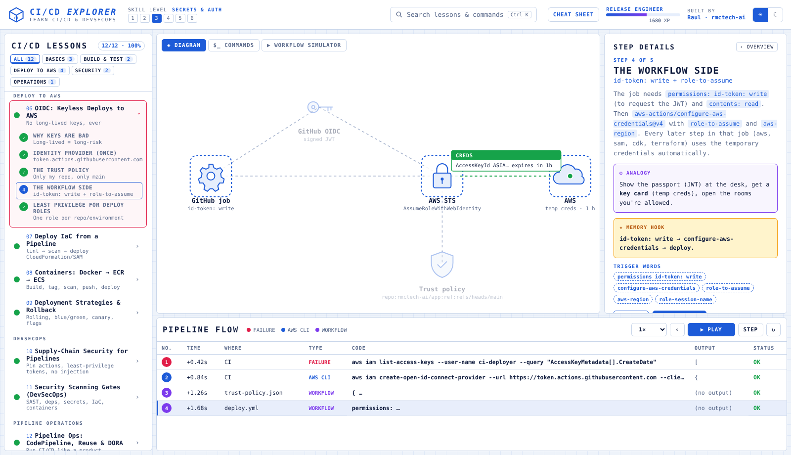

# 🚀 CI/CD Explorer — Learn CI/CD & DevSecOps with GitHub Actions and AWS

An interactive, step-by-step course on **CI/CD and DevSecOps** for Cloud Engineers: GitHub Actions from your first workflow to OIDC deploys into AWS, matrix testing, secrets and environments, IaC pipelines, containers to ECR/ECS, blue/green and canary releases, supply-chain hardening, security scanning gates and pipeline operations (CodePipeline, reusable workflows, DORA metrics). Every lesson animates how a commit flows through the pipeline, with analogies, memory hooks, trigger words, quizzes, and a **Workflow Simulator lab** that runs and security-lints your YAML.

> Created by **Raul** ([@rmctech-ai](https://github.com/rmctech-ai)) · Freelance AI Automation Specialist on the path to Cloud Security.
> Part of the Explorer series: [Linux Explorer](https://github.com/rmctech-ai/linux-explorer) · [Python Explorer](https://github.com/rmctech-ai/python-explorer) · [IAM Explorer](https://github.com/rmctech-ai/iam-explorer) · [VPC Explorer](https://github.com/rmctech-ai/vpc-explorer) · [IaC Explorer](https://github.com/rmctech-ai/iac-explorer) · [Serverless Explorer](https://github.com/rmctech-ai/serverless-explorer) · [Cloud Security Explorer](https://github.com/rmctech-ai/cloudsecurity-explorer).
> Layout framework inspired by [Protocol Explorer](https://protocol-explorer-alpha.vercel.app/) by Dilum Sanjaya.



---

## ▶ Run it

No build step. Plain HTML/CSS/JS.

```bash
python3 -m http.server 8000     # then open http://localhost:8000
```

### Publish on GitHub Pages
```bash
git init && git add . && git commit -m "CI/CD Explorer"
git branch -M main
git remote add origin https://github.com/rmctech-ai/cicd-explorer.git
git push -u origin main
```
GitHub → **Settings → Pages → Deploy from a branch → `main` / root → Save** → `https://rmctech-ai.github.io/cicd-explorer/`

---

## 🧭 How to use it

| Area | What it does |
|---|---|
| **Lessons** (left) | 12 lessons grouped by track. Click to expand steps. Dots show progress. |
| **Diagram** tab | Animated scene for every step. |
| **$_ COMMANDS** tab | Types out real commands/code for the step with realistic output. |
| **▶ WORKFLOW SIMULATOR** tab | **Workflow Simulator**: write a GitHub Actions workflow, pick an event (push to main, push to a feature branch, pull request, fork PR, tag, manual dispatch, schedule) and press RUN. The simulator checks the trigger and filters, orders jobs by `needs`, expands matrices, evaluates `if:` and `${{ }}` expressions, fakes well-known actions (checkout, setup-python, configure-aws-credentials with OIDC, ECR login, docker build-push, CloudFormation deploy), shows step logs, and runs a security linter (hard-coded keys, unpinned actions, write-all tokens, script injection, pull_request_target misuse). Each challenge re-runs your workflow under several events and tells you exactly what is still missing. |
| **Step Details** (right) | Explanation, **Analogy**, **Memory Hook**, **Trigger Words**, real-world notes, warnings. |
| **Pipeline Flow** (bottom) | Log of every command so far with type, output and status. |
| **XP & levels** | Earn XP for steps, lessons, quizzes and challenges. Saved in your browser. |
| **Cheat Sheet** | Master hooks + key syntax for every lesson (also [`CHEATSHEET.md`](CHEATSHEET.md)). |

**Keyboard:** `→` / `←` steps · `Space` play · `Ctrl+K` search · `Esc` close.

---

## 📚 Curriculum (12 lessons · 60 steps · 48 quiz questions · 12 hands-on challenges)

| # | Lesson | Track | You'll learn |
|---|---|---|---|
| 01 | What is CI/CD? ⚑ | BASICS | Automate build, test and deploy |
| 02 | GitHub Actions Anatomy & Triggers ⚑ | BASICS | Events, filters, jobs, steps, runners |
| 03 | Job Dependencies, Conditions & Artifacts ⚑ | BASICS | needs, if, outputs, artifacts |
| 04 | Testing in CI: Lint, Tests, Matrix, Cache ⚑ | BUILD & TEST | Trustworthy and fast checks |
| 05 | Secrets, Variables & Environments ⚑ | BUILD & TEST | Config, credentials and approval gates |
| 06 | OIDC: Keyless Deploys to AWS ⚑ | DEPLOY TO AWS | No long-lived keys, ever |
| 07 | Deploy IaC from a Pipeline ⚑ | DEPLOY TO AWS | lint → scan → deploy CloudFormation/SAM |
| 08 | Containers: Docker → ECR → ECS ⚑ | DEPLOY TO AWS | Build, tag, scan, push, deploy |
| 09 | Deployment Strategies & Rollback ⚑ | DEPLOY TO AWS | Rolling, blue/green, canary, flags |
| 10 | Supply-Chain Security for Pipelines ⚑ | SECURITY | Pin actions, least-privilege tokens, no injection |
| 11 | Security Scanning Gates (DevSecOps) ⚑ | SECURITY | SAST, deps, secrets, IaC, containers |
| 12 | Pipeline Ops: CodePipeline, Reuse & DORA ⚑ | OPERATIONS | Run CI/CD like a product |

⚑ = has a hands-on challenge.

## 🎯 Study plan & capstone

- **Week 1:** Lessons 1–5 (CI/CD basics, triggers, needs & if, testing with matrix and cache, secrets & environments). Solve every simulator challenge.
- **Week 2:** Lessons 6–9 (OIDC to AWS, IaC pipelines, containers to ECR/ECS, deployment strategies & rollback).
- **Week 3:** Lessons 10–12 (supply-chain security, security scanning gates, CodePipeline, reusable workflows & DORA).

**Capstone:** In your own GitHub repo, build lint → test → security gate → OIDC deploy of a SAM app to dev, a manual-approval production environment with a canary alias, and a rollback workflow. Pin every third-party action, add Dependabot, and track DORA metrics for two weeks. Document it in the README.

## License
MIT © 2026 Raul (rmctech-ai)
